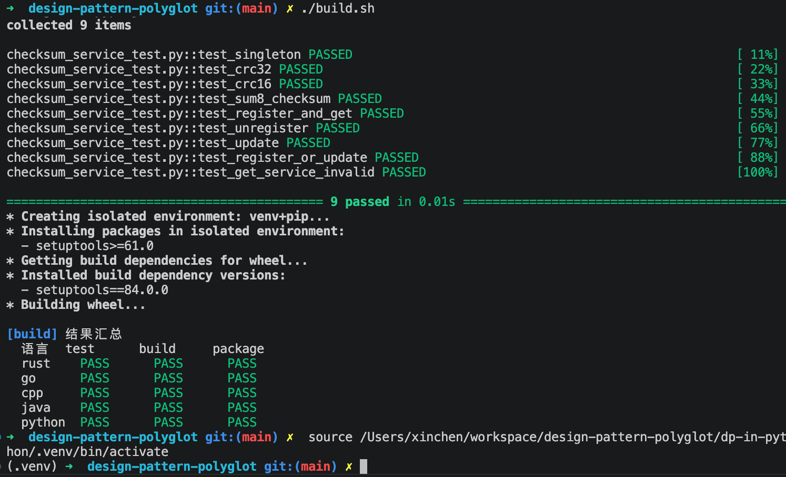

# 设计模式实战系列
证券金融（交易、风控）场景的**设计模式实战系列**：每篇一个真实业务场景，用 🦀 Rust | 🐹 Go | ⚡ C++ | ☕ Java | 🐍 Python 五语言对照实现 GoF 设计模式，配套可运行代码与测试。

## 案例目录

- 实战 1：二进制协议报文校验——策略 + 工厂 + 单例
- 实战 2：模拟撮合引擎——中介者 + 观察者 + 门面
- 实战 3：订单生命周期 OMS——状态 + 命令 + 备忘录（五语言各 12 例测试）

## 本地运行

进入任一语言目录运行 `test.sh`，或在仓库根目录执行五语言全量测试：

```
cd dp-in-xx && ./test.sh
./build.sh test --strict
```


